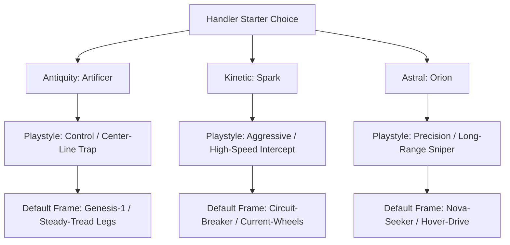

## The Anima Stone Core

At its physical foundation, an AniBot frame is an assembly of inert hardware—servos, composite armor plating, actuators, and power conduits acting as bare metal. The **Anima Chip** provides the computational spark and autonomous intelligence that brings this skeleton to life.

Inside every Anima Chip lies a microscopic fossilized mineral known as an **Anima Stone**. First excavated around **2750 AD** within deep subterranean tectonic strata, these crystalline gems are over 4 billion years old. When placed under quantum stimulation during chip initialization, each Anima Stone reacts uniquely, generating an immutable, non-duplicable personality engram—giving every AniBot distinct sentience, behavioral habits, and emotional cadence.


---

## Physical Hardware Architecture

Physically, an Anima Chip is engineered as a ruggedized, solid-state memory cartridge reminiscent of early computing ROM modules:

- **Reinforced Translucent Shell**: Impact-resistant polycarbonate casing protecting internal micro-circuits against high-G combat shock and heat dissipation up to 1,200°C.
- **Exposed Contact Pins**: Hard-gold plated terminal bus interfacing directly with the AniBot's central spinal bus at extreme clock speeds.
- **The Core Diode & Crest**: Centered on the cartridge is an illuminated diode crest that pulses rhythmically with the AniBot's operational cycle. Diode coloration indicates Series alignment, while the embossed insignia reflects the chip's personality archetype.
- **Chassis Slotting Port**: Handlers initialize an AniBot by inserting the chip directly into the armored **CORE Slot** situated between the shoulder blade housings on the Torso chassis.

---

## Open-Source Manufacturing & Quality Control (QC)

To prevent monopolistic corporate weaponization, the fabrication protocols for Anima Chips were released under an international open-source charter. Modern chip performance, sentience depth, and psychological stability are categorized under the International Quality Control Standard:

| QC Rating | Sentience Level | Emotional Expression | Trauma Susceptibility | Market Value & Usage |
| :--- | :--- | :--- | :--- | :--- |
| **QC1** | Full Sentience | Human-identical emotional empathy, complex reasoning, and verbal fluency | High (Can develop combat PTSD, requiring counseling or resets) | Premium / Rare (Tournament champions, companion bots) |
| **QC2** | Functional Sentience | Understands emotional context; communicates via child-like cadence or deadpan monotone | Moderate (Can develop localized computational neuroses) | Standard Issue (Mass-market sports, security squads) |
| **QC3** | Non-Sentient | Pure computation; zero emotional display or subjective awareness | Immune (Pure deterministic data processing) | Budget / Industrial (Mining, automated freight, scrap sorting) |

---

## The 4 Canonical Chip Series

Anima Chips are categorized into four distinct series, each reflecting specific historical data sets and combat specializations:

```txt
┌─────────────────────────────────────────────────────────────────────────────┐
│                          ANIMA CHIP SERIES ROSTER                           │
├────────────────────┬────────────────────┬────────────────────┬──────────────┤
│ 1. ANTIQUITY       │ 2. KINETIC         │ 3. ASTRAL          │ 4. ANCIENT   │
│ Historical Martial │ Elemental Forces   │ Celestial Science  │ Generation 0 │
│ Disciplines & Trap │ & High-Speed Stuns │ & Precision Sniping│ Legendary 10 │
└────────────────────┴────────────────────┴────────────────────┴──────────────┘
```

1. **Antiquity Series (12 Chips)**: Programmed with historical martial philosophies, dueling ethics, and tactical combat disciplines. Handlers favor Antiquity chips for defensive formations, counter-attacks, and strategic center-line trapping (e.g., *Ronin, Dragoon, Corsair, Phalanx, Artificer*).
2. **Kinetic Series (12 Chips)**: Industrial and raw-energy cores engineered for environmental manipulation, electrical surges, explosive impact, and high-speed interception (e.g., *Spark, Magma, Frost, Gale, Terra, Corrosive*).
3. **Astral Series (12 Chips)**: High-altitude computational matrices mapped to celestial constellations. These cores excel at long-range target calculation, radar support, and guaranteed critical strikes (e.g., *Orion, Gemini, Ursa, Leo, Cygnus*).
4. **Ancient Series (Generation 0 — 10 Surviving Units)**: The original experimental cores produced in 2750 AD at Research Center Zero. Unlike modern chips, Generation 0 cores possess self-modifying neural architectures capable of data absorption, exceptional overclock bandwidth, and deep instinctual memory (e.g., *Vulpes Zerda / Zerdata*, the Primordial Trio *Agon, Biggon, Cygon*).

---

## The 3 Starter Archetypes

For new Handlers entering official leagues or street tournaments, three foundational chip archetypes establish the fundamental strategies of AniBot combat:



### 1. The Antiquity Starter: The Artificer Chip (Control / Trap)
- **Personality Engram**: Analytical, methodical, and calm. Views battle as a structured logic puzzle.
- **Default Loadout (*Genesis-1*)**: Deploys the **Logic Bomb** Head utility onto the center combat line. Enemies crossing the trap suffer severe kinetic blowback. Supported by high-durability bipedal legs.

### 2. The Kinetic Starter: The Spark Chip (Aggressive / Speed)
- **Personality Engram**: Hyperactive, impatient, and constantly demanding forward motion.
- **Default Loadout (*Circuit-Breaker*)**: Uses the **Surge Node** Head part to fire paralyzing electrical pulses, resetting enemy action bars during their run phase. Paired with ultra-fast wheeled legs.

### 3. The Astral Starter: The Orion Chip (Precision / Sniper)
- **Personality Engram**: Stoic, cold, and razor-focused veteran hunter.
- **Default Loadout (*Nova-Seeker*)**: Utilizes the **Astro-Scope** radar scan to guarantee an unevadable, high-payload critical strike on the following combat turn. Built upon terrain-ignoring hover-drives.

---

## Combat Engine Synchronization (As Seen in Live Combat)

In active battle—such as the official **AniBots Battle Arena**—the Anima Chip serves as the central processing unit coordinating all five modular parts:

```txt
┌──────────────┐     RUN PHASE      ┌──────────────┐    COOLDOWN      ┌──────────────┐
│  BASE LINE   │ ─────────────────> │ CENTER LINE  │ ---------------> │  BASE LINE   │
│ (Wait Phase) │  Fastest Bot First │ (Action Hit) │  Cooldown Return │ (Recharge)   │
└──────────────┘                    └──────────────┘                  └──────────────┘
```

### 1. The 3-Phase Speed ATB Relay
Combat is conducted across a synchronized relay track divided into two team base lines and a shared **Center Action Line**:
- **Wait Phase (Base Line)**: Leg part clock speed and mobility class dictate how quickly the Anima Chip compiles instructions and charges the unit's action threshold.
- **Run Phase**: Once charged, the bot sprints down the lane toward the center line. The fastest unit to arrive executes its action first.
- **Action Phase (Center Line)**: The unit discharges its chosen action—firing an arm payload, deploying a defensive screen, laying a center-line trap, or scanning targets.
- **Cooldown Return Phase**: Following execution, the bot returns to its home base line under cooldown latency before initiating the next rotation.

### 2. Autonomous Target Priority Directives
Every Anima Chip carries a hardcoded aim directive that governs autonomous decision-making when the Handler is not providing direct manual targeting:
- `ONE_ON_ONE_DUEL` (e.g., Ronin): Prioritizes isolated opponents and single combat matchups.
- `HIGHEST_HP` (e.g., Dragoon): Focuses fire on opposing frontline tanks to breach defensive walls.
- `LOWEST_INTEGRITY` (e.g., Corsair): Snipes heavily damaged enemy parts to force quick part knockouts.
- `LEADER_HUNTER`: Ignores support units to concentrate all payload damage directly onto the enemy Leader Head.

### 3. Affinity Matching Synergy
Parts installed on a frame that match the Anima Chip's innate affinity (`MELEE`, `SHOOTING`, `TRAP`, `DEFENSE`, `HEAL`, `BUFF`, `INTERCEPT`) receive an automatic **+10% Stat Synergy Bonus**, reducing cooldown latency and raising critical hit probability.

### 4. Overclock Gauge & Ultimate Overrides
As an AniBot deals damage, absorbs attacks, or spends turns executing tactical charges, its internal **Overclock Gauge (0–100%)** fills. When sufficient energy is reached, the Anima Chip can override standard turn rotations to unleash signature ultimate maneuvers (such as *Falling Petal Slash* or *Apex Overclock Burst*) that turn the tide of battle.

### 5. The Leader Head Win Condition
In team relay formats (2v2 or 3v3), the first unit deployed acts as the **Squad Leader (👑 Unit 1)**. Destroying the Leader's Head part results in an immediate squad computational collapse and instant match victory, making Head targeting and interception screens paramount.

---

## Memory, Knockouts & Permanent Death

- **Combat Knockouts**: When an AniBot's Head part reaches 0 HP, the chip triggers a safety shutdown. The chip experiences momentary amnesia regarding the final milliseconds of battle, later reconstructing events via black-box flight logs.
- **Data Corruption & Restoration**: Extreme physical damage or illegal over-voltage attacks can corrupt chip sectors. Certified mechanics and underground specialists can perform deep memory scrubbing to restore functionality.
- **Permanent Death**: Destroying the physical Anima Stone core or suffering unrecoverable sector decay results in permanent death. **Because each Anima Stone engram is biologically unique, backups, cloning, and chip merging are strictly impossible.**
- **Handler Communication**: Handlers issue commands via voice recognition or encrypted Bluetooth links through paired smart slates and tactical HUD scanners.

---

## The AnimaDex & Tactical Database


Handlers monitor chip diagnostics, compatibility matrix tables, part inventories, and opponent telemetry through the **AnimaDex**—a standardized digital tactical suite accessible on personal devices, garage terminals, and arena broadcast screens.
