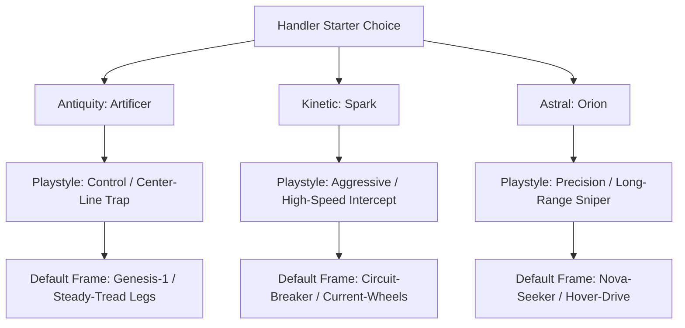

## The Anima Stone Core

At its physical foundation, an AniBot frame is an assembly of inert hardware—servos, composite armor plating, actuators, and power conduits acting as bare metal. The **Anima Chip** provides the computational spark and autonomous intelligence that brings this skeleton to life.


### 1. Complete Form & Natural Variations

Anima Stones are rare, naturally occurring geological crystals that contain condensed **Anima**—a primordial form of pure life energy dating back over 4 billion years:

- **Physical Dimensions**: A complete, unharvested crystal measures approximately **70 mm (2.76 in)** in height by **30 mm (1.18 in)** in width.
- **Natural Variations**: Anima Stones manifest in diverse geological formations—from pristine elongated hexagonal prisms to dense geode clusters and faceted shard aggregates.

### 2. Internal Anatomy: Shell & Core

When split open, an Anima Stone reveals a two-layer biological-crystalline architecture:

```text
┌────────────────────────────────────────────────────────┐
│                 ANIMA STONE ANATOMY                    │
├────────────────────────────────────────────────────────┤
│ 1. OUTER SHELL                                         │
│    Translucent crystalline facet structure that holds, │
│    protects, and naturally channels internal energy.   │
│                                                        │
│ 2. THE CORE (ANIMA)                                    │
│    A luminous, spherical energy nucleus measuring      │
│    3 mm (0.12 in) in diameter situated at the center.  │
│    The ultimate source of life energy and resonance.   │
└────────────────────────────────────────────────────────┘
```

---

## The Resonance Spectrum

Every Anima Core vibrates with a distinct, non-duplicable frequency. **Resonance is a continuous spectrum with near-infinite variations**, ensuring that no two Anima Cores—even when harvested from the same geological vein—are ever identical.

While each core's wavelength is unique, frequencies broadly align into **five primary resonance categories**, which dictate the core's baseline temperament, cognitive traits, and the color of light it naturally emits:

| Category | Primary Wavelength | Trait Focus | Personality & Combat Archetype |
| :--- | :--- | :--- | :--- |
| **CALM** | Cyan / Deep Blue | **Stability** | Serene, measured, and resilient under pressure; favors defensive posturing and counter-strikes. |
| **ANALYTICAL** | Emerald Green | **Intelligence** | Methodical, calculation-heavy, and structured; optimizes action economy and center-line traps. |
| **BOLD** | Amber / Gold | **Courage** | Confident, chivalric, and steadfast; commands frontline assaults and inspired morale. |
| **INTUITIVE** | Amethyst / Violet | **Perception** | Perceptive, acoustic-sensitive, and agile; anticipates enemy vectors and exploits structural weak points. |
| **FIERY** | Crimson / Ruby Red | **Passion** | Aggressive, hyperactive, and intense; excels at high-speed sprints and rapid-fire offensive surges. |

---

## Anima Chip Integration & Form Factor

To harness the core's power for tactical robotics, the **3 mm Anima Core** is carefully extracted from the crystal shell and integrated into a standardized modular cartridge:


### 1. Standard Cartridge Dimensions
- **Length**: **45 mm (1.77 in)**
- **Width**: **35 mm (1.38 in)**
- **Thickness**: **5 mm (0.20 in)**

### 2. Layered Cutaway Architecture
1. **Top Polycarbonate Shell**: Transparent or tinted protective faceplate featuring the embossed Series insignia and model crest.
2. **Core Placement**: The **3 mm Anima Core** is suspended directly behind the central emblem, projecting its resonant glow outward through the diode lens.
3. **Internal Carrier Circuitry**: High-frequency substrate holding the core, regulating power draw, and translating biological resonance waves into digital neural directives.
4. **Bottom Housing & Terminal Pins**: Hardened rear shell with exposed hard-gold contact bus pins interfacing with the AniBot's central spinal bus at extreme clock speeds.
5. **Chassis Slotting Port**: Handlers initialize an AniBot by inserting the chip directly into the armored **CORE Slot** situated between the shoulder blade housings on the back of Torso chassis.

---

## Core Vitality, Lifespan & Depletion

- **Average Lifespan (125 Years)**: Once removed from its native geological crystal shell and initialized inside an operational cartridge, an Anima Core has an average functional lifespan of **125 years**.
- **The Active State (Core Alive)**: While the Anima Core lives, the chip pulses with continuous illumination matching its individual resonance color. This pulsing rhythm synchronizes with the AniBot's operational cycle like a heartbeat.
- **The Inactive State (Core Depleted)**: When a core reaches the end of its 125-year lifespan or suffers catastrophic engram collapse from extreme trauma, the resonance fades and the light extinguishes. The cartridge enters a permanently inert **Inactive** state. Because Anima engrams are biologically unique, a depleted core cannot be recharged, cloned, or duplicated.

---

## Open-Source Manufacturing & Quality Control (QC)

To prevent monopolistic corporate weaponization, the fabrication protocols for Anima Chips were released under an international open-source charter. Modern chip performance, sentience depth, and psychological stability are categorized under the International Quality Control Standard:

| QC Rating | Sentience Level | Emotional Expression | Trauma Susceptibility | Market Value & Usage |
| :--- | :--- | :--- | :--- | :--- |
| **QC1** | Full Sentience | Human-identical emotional empathy, complex reasoning, and verbal fluency | High (Can develop combat PTSD, requiring counseling or resets) | Premium / Rare (Tournament champions, companion bots) |
| **QC2** | Functional Sentience | Understands emotional context; communicates via child-like cadence or deadpan monotone | Moderate (Can develop localized computational neuroses) | Standard Issue (Mass-market sports, security squads) |
| **QC3** | Non-Sentient | Pure computation; zero emotional display or subjective awareness | Immune (Pure deterministic data processing) | Budget / Industrial (Mining, automated freight, scrap sorting) |

---

## Chip Series Genealogy: From Lab Prototype to Corporate Industry

The development of Anima Chips spans centuries, originating in government research laboratories before expanding into commercial robotics corporations:

1. **Laboratory Origins (Ancient Series — Generation 0)**:
   - Fabricated in **2750 AD** by human scientists and researchers in dedicated robotics laboratories.
   - Only **176 prototype units** were produced before the initiative was decommissioned.
   - Characterized by self-modifying code, learning absorption, and unmatched overclock headroom.

2. **Corporate Mass-Market Manufacturing**:
   - Following the release of the Open-Source Anima Charter, competitive corporations industrialized production, establishing specialized branded series:
     - **Aegis Corporation**: Engineers the **Antiquity Series** (historical martial disciplines) and **Primal Series** (beast combat instincts).
     - **Atom Corp**: Engineers the **Kinetic Series** (industrial mobility & stuns) and **Astral Series** (celestial precision & optics).
     - **ABFE (AniBots For Everyone)**: Engineers the **Neutral Series** (balanced civic utility) and **Pex Series** (modular expansion).

> [!TIP]
> For complete visual identity systems, color palettes, and frame rosters of all 7 series, see **[Chip Series Lore](/lore/04_chip_series)**. For deep dives on the three corporate giants, see **[Robotics Manufacturers](/lore/05_manufacturers)**.

---

## The 3 Starter Archetypes

For new Handlers entering official leagues or street tournaments, three foundational chip archetypes establish the fundamental strategies of AniBot combat:



### 1. The Antiquity Starter: The Artificer Chip (Control / Trap)
- **Personality Engram**: Analytical, methodical, and calm. Views battle as a structured logic puzzle.
- **Default Loadout (*Genesis-1*)**: Deploys the **Logic Bomb** Head utility onto the center combat line. Enemies crossing the trap suffer severe kinetic blowback. Supported by high-durability bipedal legs.

### 2. The Kinetic Starter: The Spark Chip (Aggressive / Speed)
- **Personality Engram**: Hyperactive, impatient, and constantly demanding forward motion.
- **Default Loadout (*Circuit-Breaker*)**: Uses the **Surge Node** Head part to fire paralyzing electrical pulses, resetting enemy action bars during their run phase. Paired with ultra-fast wheeled legs.

### 3. The Astral Starter: The Orion Chip (Precision / Sniper)
- **Personality Engram**: Stoic, cold, and razor-focused veteran hunter.
- **Default Loadout (*Nova-Seeker*)**: Utilizes the **Astro-Scope** radar scan to guarantee an unevadable, high-payload critical strike on the following combat turn. Built upon terrain-ignoring hover-drives.

---

## Combat Engine Synchronization (As Seen in Live Combat)

In active battle—such as the official **AniBots Battle Arena**—the Anima Chip serves as the central processing unit coordinating all five modular parts:

```txt
┌──────────────┐     RUN PHASE      ┌──────────────┐    COOLDOWN      ┌──────────────┐
│  BASE LINE   │ ─────────────────> │ CENTER LINE  │ ---------------> │  BASE LINE   │
│ (Wait Phase) │  Fastest Bot First │ (Action Hit) │  Cooldown Return │ (Recharge)   │
└──────────────┘                    └──────────────┘                  └──────────────┘
```

### 1. The 3-Phase Speed ATB Relay
Combat is conducted across a synchronized relay track divided into two team base lines and a shared **Center Action Line**:
- **Wait Phase (Base Line)**: Leg part clock speed and mobility class dictate how quickly the Anima Chip compiles instructions and charges the unit's action threshold.
- **Run Phase**: Once charged, the bot sprints down the lane toward the center line. The fastest unit to arrive executes its action first.
- **Action Phase (Center Line)**: The unit discharges its chosen action—firing an arm payload, deploying a defensive screen, laying a center-line trap, or scanning targets.
- **Cooldown Return Phase**: Following execution, the bot returns to its home base line under cooldown latency before initiating the next rotation.

### 2. Autonomous Target Priority Directives
Every Anima Chip carries a hardcoded aim directive that governs autonomous decision-making when the Handler is not providing direct manual targeting:
- `ONE_ON_ONE_DUEL` (e.g., Ronin): Prioritizes isolated opponents and single combat matchups.
- `HIGHEST_HP` (e.g., Dragoon): Focuses fire on opposing frontline tanks to breach defensive walls.
- `LOWEST_INTEGRITY` (e.g., Corsair): Snipes heavily damaged enemy parts to force quick part knockouts.
- `LEADER_HUNTER`: Ignores support units to concentrate all payload damage directly onto the enemy Leader Head.

### 3. Affinity Matching Synergy
Parts installed on a frame that match the Anima Chip's innate affinity (`MELEE`, `SHOOTING`, `TRAP`, `DEFENSE`, `HEAL`, `BUFF`, `INTERCEPT`) receive an automatic **+10% Stat Synergy Bonus**, reducing cooldown latency and raising critical hit probability.

### 4. Overclock Gauge & Ultimate Overrides
As an AniBot deals damage, absorbs attacks, or spends turns executing tactical charges, its internal **Overclock Gauge (0–100%)** fills. When sufficient energy is reached, the Anima Chip can override standard turn rotations to unleash signature ultimate maneuvers (such as *Falling Petal Slash* or *Apex Overclock Burst*) that turn the tide of battle.

### 5. The Leader Head Win Condition
In team relay formats (2v2 or 3v3), the first unit deployed acts as the **Squad Leader (👑 Unit 1)**. Destroying the Leader's Head part results in an immediate squad computational collapse and instant match victory, making Head targeting and interception screens paramount.

---

## Memory, Knockouts & Permanent Death

- **Combat Knockouts**: When an AniBot's Head part reaches 0 HP, the chip triggers a safety shutdown. The chip experiences momentary amnesia regarding the final milliseconds of battle, later reconstructing events via black-box flight logs.
- **Data Corruption & Restoration**: Extreme physical damage or illegal over-voltage attacks can corrupt chip sectors. Certified mechanics and underground specialists can perform deep memory scrubbing to restore functionality.
- **Permanent Death**: Destroying the physical Anima Stone core or suffering unrecoverable sector decay results in permanent death. **Because each Anima Stone engram is biologically unique, backups, cloning, and chip merging are strictly impossible.**
- **Handler Communication**: Handlers issue commands via voice recognition or encrypted Bluetooth links through paired smart slates and tactical HUD scanners.

---

## The AnimaDex & Tactical Database


Handlers monitor chip diagnostics, compatibility matrix tables, part inventories, and opponent telemetry through the **AnimaDex**—a standardized digital tactical suite accessible on personal devices, garage terminals, and arena broadcast screens.
